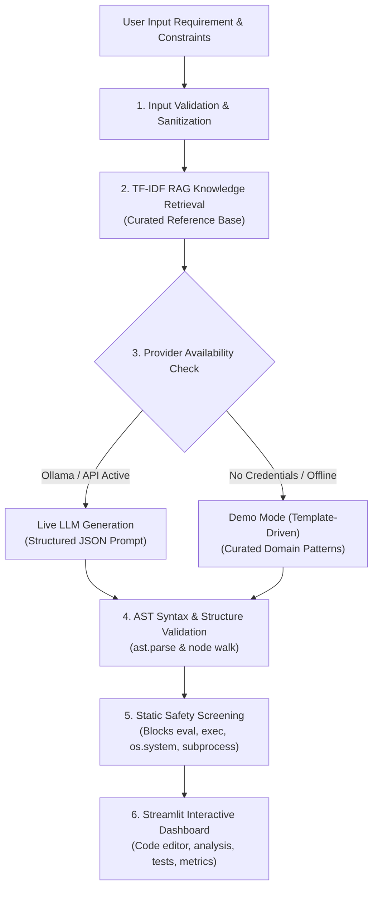

# AI Code Snippet Generator (CodeForge AI)

> **Natural Language Requirements → Production-Ready, Syntactically Validated Python Code**  
> Built for the TCS Technology Day Hackathon Problem Statement.

---

## 1. Project Overview & Objectives

The **AI-Powered Code Snippet Generator** transforms plain natural-language software requirements into readable, executable, and secure Python code. It is designed to assist developers and students by providing:
- Production-grade, PEP 8-compliant Python code snippets.
- Comprehensive technical explanations of design decisions and algorithms.
- Concrete input and output verification examples.
- Self-contained, runnable unit tests (`unittest`-compatible).
- Multi-stage AST syntax validation and static safety screening.
- Fast, zero-cost semantic context retrieval via TF-IDF RAG.
- Flexible multi-provider support (Local Ollama, OpenAI-compatible APIs, and a deterministic Demo / Template Mode when credentials are not configured).

---

## 2. Architecture & Pipeline



### Supported Requirement Domains
1. **Mathematical Operations:** Prime checkers (`is_prime`), Fibonacci generators, GCD/LCM.
2. **Data Processing & CSV:** Pandas CSV deduplication, department salary aggregation, filtering.
3. **String Manipulation:** Palindrome verification, anagram detection, word frequencies.
4. **File Operations:** Safe line-by-line streaming, keyword filtering, directory traversals.
5. **API Requests:** HTTP GET/POST with query parameters, status checks, timeouts, and JSON parsing.
6. **Input Validation:** Email, username, and password format validation with custom exceptions.
7. **Database Operations:** SQLite table creation, parameterized queries (`?`), and transactions.
8. **Algorithms & Data Structures:** Binary search, queue/stack implementations, sorting.

---

## 3. Folder Structure

```
.
├── backend/
│   ├── __init__.py           # Package exports (generate, validate_code_pipeline, etc.)
│   ├── generator.py          # Unified code generator (Ollama, API, Demo mode fallback)
│   ├── rag.py                # TF-IDF RAG retriever and curated reference dataset
│   ├── prompts.py            # Structured system/user prompts & resilient response parser
│   ├── pipeline.py           # AST validation & safety screening orchestrator
│   ├── validator.py          # AST syntax validity and structural statistics
│   ├── safety.py             # AST security screening (blocks dangerous calls/imports)
│   └── correction.py         # Self-correction prompt builder & Ollama caller
├── frontend/
│   ├── app.py                # Streamlit enterprise dashboard UI
│   └── README.md             # UI developer documentation
├── TCS Hackthon/             # QA and Testing Workspace
│   ├── data/
│   │   └── multilingual_test_cases.csv # Multilingual test cases (Kannada, Hindi, Urdu, English)
│   ├── docs/                 # QA handover, checklists, limitations
│   ├── tests/                # Unit, integration, safety, and UI test suites
│   │   ├── test_validator.py
│   │   ├── test_safety_checker.py
│   │   ├── test_requirement_processor.py
│   │   ├── test_integration.py
│   │   ├── test_frontend.py
│   │   ├── test_normalization.py
│   │   ├── test_translation.py
│   │   └── test_multilingual_flow.py
│   └── requirements.txt
├── .env.example              # Environment variable template
├── requirements.txt          # Python project dependencies
├── run_tests.py              # Automated test runner (unittest & pytest compatible)
└── README.md                 # Project documentation
```

---

## 4. Technologies Used

- **Language:** Python 3.10+ (Tested on Python 3.13)
- **Frontend / UI:** Streamlit (`1.55.0`) with custom Glassmorphism enterprise CSS
- **Vector Search / RAG:** `scikit-learn` (`TfidfVectorizer`, Cosine Similarity)
- **Data Handling:** `pandas`, `numpy`
- **HTTP / REST:** `requests`
- **Code Parsing & Safety:** Python built-in `ast` module (no arbitrary code execution)
- **Testing:** Python built-in `unittest` and `streamlit.testing.v1.AppTest`

---

## 5. Quick Start & Execution

### Prerequisites
Make sure Python 3.10 or newer is installed.

```bash
# Verify Python version
python --version
```

### Install Dependencies
```bash
pip install -r requirements.txt
```

### Run the Application (Streamlit Frontend)
From the project root (`D:\Desktop\TCS hackthon`):

```bash
python -m streamlit run frontend/app.py
```
Open your browser at `http://localhost:8501`.

### Run Automated Tests
Execute the complete test suite (35 tests):

```bash
python run_tests.py
```
Or using pytest if installed:
```bash
pytest "TCS Hackthon/tests"
```

---

## 6. AI Provider Configuration

The generator automatically selects the best available engine:

### 1. Demo / Template Mode (Zero Setup Required)
- **Default mode** when no environment variables or local Ollama are detected.
- Uses TF-IDF semantic search over the curated knowledge base.
- Clearly displays `Demo Mode (Template-Driven)` in the UI header and audit cards.
- **No API keys or internet connection required.**

### 2. Local Ollama (Local LLM)
If you run Ollama locally (`http://localhost:11434`):
1. Start Ollama: `ollama run qwen2.5-coder`
2. Set optional environment variable:
   ```bash
   set OLLAMA_MODEL=qwen2.5-coder
   ```
3. CodeForge AI auto-detects Ollama on startup.

### 3. OpenAI or Compatible Cloud API
To use OpenAI, Groq, OpenRouter, or Gemini's OpenAI-compatible endpoint:
```bash
set LLM_API_KEY=your_api_key_here
set LLM_MODEL=gpt-4o-mini
# Optional custom base URL:
set LLM_BASE_URL=https://api.openai.com/v1
```

---

## 7. Python Code Validation & Safety Guarantees

CodeForge AI strictly enforces safety boundaries:
1. **Never Automatically Executes Generated Code:** Generated code is treated as untrusted and is validated strictly via Python's AST parser (`ast.parse`).
2. **Disallowed Invocations Flagged:**
   - Functions: `eval()`, `exec()`, `compile()`, `__import__()`
   - Attributes: `os.system()`, `os.popen()`, `os.remove()`, `os.rmdir()`, `os.unlink()`
   - Modules: `subprocess`, `ctypes`, `pickle`, `marshal`
3. **Graceful Error Recovery:** Syntax errors are caught with exact line and column numbers and displayed to the user with a retry trigger.

---

## 8. Test Execution Summary

The project includes 35 comprehensive automated tests covering:
- Empty and invalid requirement rejection (`test_requirement_processor.py`)
- Python AST syntax and structural counting (`test_validator.py`)
- Static safety screening and dangerous call detection (`test_safety_checker.py`)
- End-to-end generation contract schemas and mock LLM providers (`test_integration.py`)
- TF-IDF semantic RAG similarity and ranking (`test_integration.py`)
- Streamlit UI component rendering and button actions (`test_frontend.py`)
- Multilingual requirement dataset integrity and flows (`test_translation.py`, `test_multilingual_flow.py`)

All 35 tests pass with 0 failures and 0 errors.

## 🚀 Live Demo

Try CodeForge AI here:

**[Open CodeForge AI Live Demo](https://ai-code-snippet-generator-jvjpmk6md4ytkvm7vxkxj8.streamlit.app/)**


